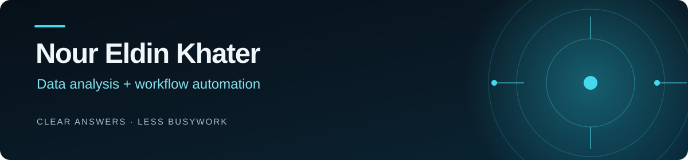

  

  <a href="https://nour2303.github.io/">Portfolio</a> ·
  <a href="https://nour2303.github.io/Nour-Khater-CV.pdf">CV</a> ·
  <a href="https://www.linkedin.com/in/nour-eldin-khater">LinkedIn</a> ·
  <a href="mailto:nourkhater39@gmail.com">Email</a>

I'm Nour, a Management Information Systems graduate based in Egypt (Military Status: Exempted). I turn data into clear reports for stakeholders and build AI workflows that eliminate repetitive manual tasks. At the Information and Decision Support Center (IDSC), Cabinet of Ministers of Egypt, I worked as a Data Analyst Intern & Policy Lab Trainee and was awarded the **IDSC Policy Lab Certificate of Excellence** (signed by the Assistant to the Prime Minister of Egypt). I also hold the **Google Data Analytics Professional Certificate**.

### Selected work

- **[Sales Analysis](https://github.com/nour2303/sales-profitability-analysis)** — Audited 113,000 sales records, flagged fabricated duplicate records, and built an Excel dashboard showing product margins (helmets at 59%) and how discounts cut margins from 51% to 31%.
- **[E-commerce Sales Analysis](https://github.com/nour2303/ecommerce-sales-analysis)** — Cleaned 131,000+ sales records in MySQL and built a two-page Power BI dashboard analyzing revenue concentration, cancellations, and category growth.
- **[Firm Assistant](https://github.com/nour2303/firm-assistant)** — Three-workflow n8n RAG and read-only SQL assistant with semantic caching, request logging, guardrails, and automated evaluations.
- **[Nile Auto AI Voice Receptionist](https://github.com/nour2303/nile-auto-ai-voice-receptionist)** — Bilingual (English & Egyptian Arabic) AI voice receptionist using ElevenLabs, n8n, Google Calendar, Google Sheets, and Vonage SMS confirmations.
- **[Research & Report Automation](https://github.com/nour2303/research-automation)** — Four-workflow multi-agent n8n system that gathers web sources, verifies quotations against source pages, and generates cited PDF reports with comparison charts.
- **[E-commerce Data Quality Checks (Pandas)](https://github.com/nour2303/amazon-sales-pandas)** — Python & pandas workflow for schema standardization, date/amount parsing, deduplication, and data quality profiling.

**Core Stack:** SQL / MySQL · Power BI & DAX · Excel & Power Query · Python / pandas · n8n · RAG & Multi-Agent Workflows · Supabase / PostgreSQL · REST APIs
