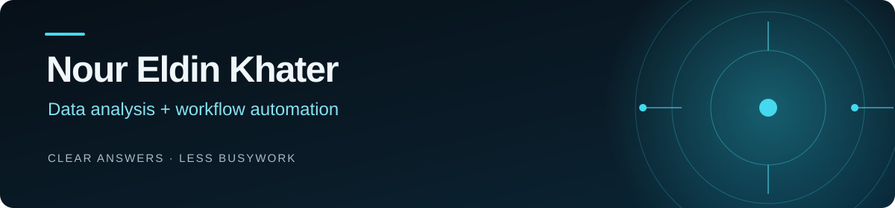

  

  <a href="https://nour2303.github.io/">Portfolio</a> ·
  <a href="https://nour2303.github.io/Nour-Khater-CV.pdf">CV</a> ·
  <a href="https://www.linkedin.com/in/nour-eldin-khater">LinkedIn</a> ·
  <a href="mailto:nourkhater39@gmail.com">Email</a>

I'm Nour, a Management Information Systems graduate based in Egypt. I use data to answer practical business questions and build workflows that take repetitive tasks off people's hands. At the Information and Decision Support Center (IDSC), I worked as a Data Analyst Intern and Policy Lab Trainee; my CV records a Policy Lab certificate for distinguished performance and analytical contribution. I'm open to data analysis and automation roles, including remote work, and freelance projects.

### Selected work

- **[Sales Analysis](https://github.com/nour2303/sales-profitability-analysis)** — Checked the sales data before studying product margins and the effect of discounts in Excel.
- **[E-commerce Sales Analysis](https://github.com/nour2303/ecommerce-sales-analysis)** — Used SQL for cleaning and Power BI to investigate falling revenue, cancelled orders, and areas with growth.
- **[Firm Assistant](https://github.com/nour2303/firm-assistant)** — Personal n8n assistant for document and read-only database questions, with evaluation tests for request handling.
- **[Nile Auto AI Voice Receptionist](https://github.com/nour2303/nile-auto-ai-voice-receptionist)** — Controlled voice-booking demo for a fictional Cairo car-care business, with calendar checks, records, and SMS confirmation.
- **[Research & Report Automation](https://github.com/nour2303/research-automation)** — Personal n8n workflow that gathers web sources and turns them into a reviewable PDF report.
- **[Pandas quality checks](https://github.com/nour2303/amazon-sales-pandas)** — A small practice notebook for parsing and profiling a sample of the e-commerce data.

I work with **SQL, Excel, Power BI, Python, n8n, APIs, and PostgreSQL**. The portfolio has the full stories, visuals, and a way to get in touch.
